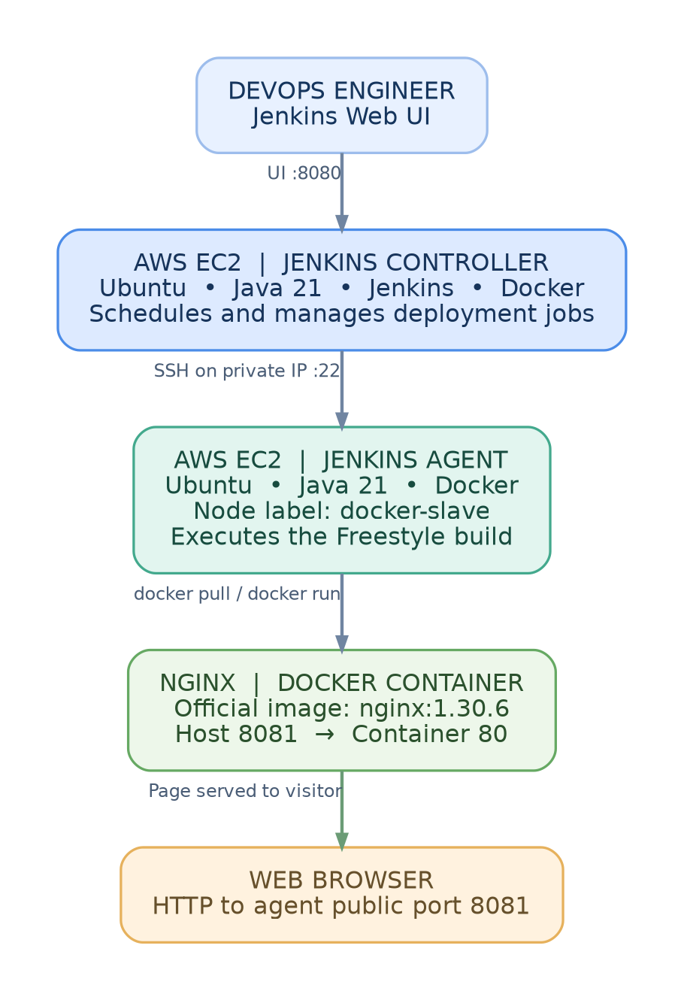

# Jenkins Controller-Agent Docker Deployment on AWS EC2

A hands-on infrastructure and deployment automation project using two Ubuntu EC2 instances, Jenkins, SSH, Docker, and Nginx.

The Jenkins controller schedules Freestyle jobs on a separate SSH agent. Docker runs the official Nginx container on the agent, with host port **8081** mapped to container port **80**.



## Complete walkthrough

[Read the complete project PDF](Jenkins%20Controller-Agent%20Docker%20Deployment%20on%20AWS%20EC2.pdf)

## What I implemented

- Set up a Jenkins controller and a separate Ubuntu agent on AWS EC2.
- Configured RSA SSH authentication and registered the permanent node `docker-slave`.
- Ran Freestyle jobs remotely and verified the execution user, workspace, and Docker access.
- Deployed Nginx on the agent and opened its welcome page through port 8081.
- Resolved mismatched SSH keys and a Jenkins temporary-space monitoring issue.

## Guides

1. [Infrastructure and tool installation](docs/01-infrastructure-setup.md)
2. [SSH keys, credentials, and agent registration](docs/02-ssh-and-agent.md)
3. [Freestyle jobs and Docker deployment](docs/03-jenkins-jobs-and-deployment.md)
4. [Troubleshooting](docs/04-troubleshooting.md)
5. [Validation and cleanup](docs/05-validation-and-cleanup.md)
6. [Official references](docs/06-official-references.md)

## Reusable shell scripts

| File | Purpose |
| --- | --- |
| [verify-agent.sh](scripts/verify-agent.sh) | Displays the node, host, Linux user, workspace, Docker version, and running containers. |
| [deploy-nginx.sh](scripts/deploy-nginx.sh) | Pulls Nginx, replaces the named container, and checks its local HTTP endpoint with retries. |

The lab used commands pasted into Jenkins **Execute shell** steps. These scripts package equivalent commands for reuse; they are not evidence that Jenkins checked out or ran these files during the original lab.

Run them with Bash on the configured agent, where Java, Docker, curl, and the required Docker permissions are already available:

```bash
bash scripts/verify-agent.sh
bash scripts/deploy-nginx.sh
```

The deployment script replaces only the container named `jenkins-nginx` and publishes port 8081. It uses the lab's Nginx tag `nginx:1.30.6`.

## Evidence

- [Agent online](assets/screenshots/01-agent-online.png)
- [Remote job success](assets/screenshots/02-remote-job-success.png)
- [Docker access success](assets/screenshots/03-docker-access-success.png)
- [Temporary-space warning](assets/screenshots/04-temp-threshold-warning.png)
- [tmpfs verification](assets/screenshots/05-tmpfs-evidence.png)

### Final Nginx website output


## Project scope

This repository contains documentation, diagrams, evidence, and reusable shell scripts. It deploys the official Nginx image; there is no custom web application or Jenkinsfile. GitHub-triggered builds, automated tests, image builds, and a declarative pipeline are future improvements.

Use this as an isolated training lab. Restrict inbound SSH, Jenkins, and Nginx access to approved sources. Docker group membership grants root-equivalent host privileges. Never commit private keys or credentials. See the validation guide for cleanup steps.
