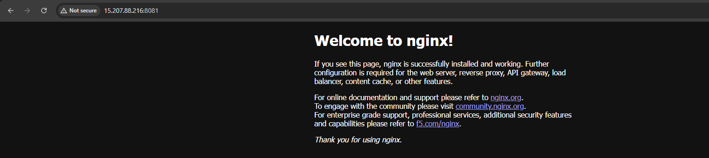

# 05 — Validation, Evidence Collection and Lab Cleanup

[← Home](../README.md) · [← Troubleshooting](04-troubleshooting.md)

## What was actually verified

| Check | Evidence or source | State |
| --- | --- | --- |
| SSH controller → agent | Successful SSH connection described in project session | Completed |
| Agent online in Jenkins | Real sanitized node dashboard screenshot | Completed |
| Jenkins job ran on agent | Freestyle build #1 console `Building remotely on docker-slave`, `whoami ubuntu` | Completed |
| Jenkins could run Docker | Freestyle build #2 console Docker `29.9.2`, `docker ps`, `SUCCESS` | Completed |
| Nginx site accessible | Project owner successfully opened Nginx in browser | Completed — browser screenshot included |



The deployment console and a post-deployment container listing are not included in the supplied evidence.

## Quick on-agent checks

```bash
docker ps --filter name=jenkins-nginx
docker container inspect jenkins-nginx --format '{{.State.Status}}'
curl --fail --head http://127.0.0.1:8081/
```

`curl` should return a successful HTTP status such as `200 OK` if the default Nginx page is available. A container may be running even if HTTP readiness is not yet achieved; check logs if health checks fail:

```bash
docker logs --tail 50 jenkins-nginx
```

## Safe teardown (avoid unexpected AWS charges)

These commands deliberately target **only this lab's named container**:

```bash
# Agent EC2, when the lab is finished
docker rm -f jenkins-nginx
```

Optional remove the specific cached image after checking no other containers use it:

```bash
docker image rm nginx:1.30.6
```

In AWS Console, stop or terminate **both** lab instances when appropriate. Understand that stopped EC2 instances can still incur EBS or other charges; review associated storage, elastic IPs/public IPv4 charges, snapshots and other AWS billable resources. Avoid deleting shared company resources. Remove temporary Security Group rules and revoke the Jenkins SSH credential when permanently retiring the lab.

## Project boundary

This project demonstrates SSH-agent-based remote job execution plus Docker deployment of a prebuilt image. It does not implement a GitHub webhook, automated test suite, Docker image build or multi-stage Jenkins pipeline.
